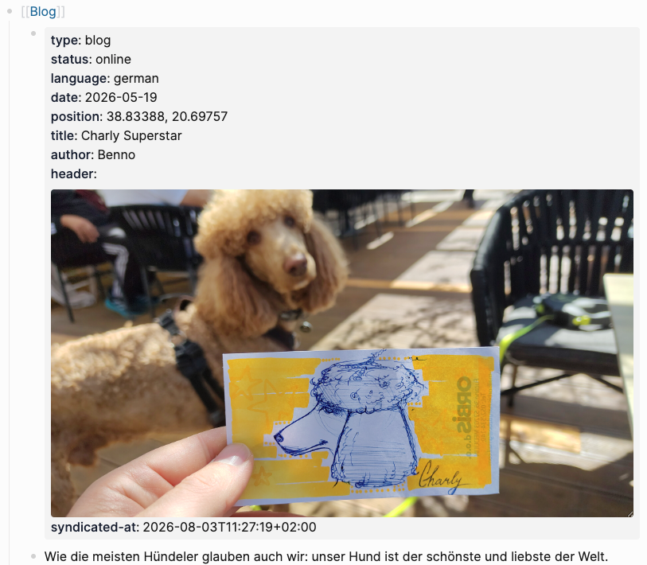

# Logseq-Blogger

Use [Logseq](https://logseq.com) as your blog editor. Write posts in your graph and mark them with `type:: blog` property. Logseq-Blogger discovers them and when you set the property `status:: online` invokes [syndicator](https://github.com/bbaumgartner/syndicator).



## Architecture

```
                logseq-blog                         syndicate
[Logseq Graph]───────○ )───────[Logseq-Blogger]───────( ○───────[Syndicator]
```
Logseq-Blogger uses the `logseq-blog` interface to retrieve blog posts from a Logseq Graph and forwards these blog posts to Syndicator using the `syndicate` interface. 

* The [logseq-blog interface](#logseq-blog-interface) is specified below. 
* The `syndicator` interface is specified in [syndicator](https://github.com/bbaumgartner/syndicator). 

## Commands

```bash
uv run logseq-blogger syndicate                 # full syndication of all ::online blog posts that have no ::syndicated-at
uv run logseq-blogger list                      # list slug of all blog posts with there ::syndicated-at status
uv run logseq-blogger syndicate --post <slug>   # full syndication of the blog post with the given slug
uv run logseq-blogger redeploy --post <slug>    # regenerate the static hugo page for the blog post with the given slug
uv run logseq-blogger version                   # print version
```

## logseq-blog interface

The **logseq-blog** interface is the contract between a Logseq Graph and Logseq-Blogger. A blog post is a Logseq markdown fragment marked with `type:: blog`.

### Discovery

Under the Logseq graph root (`logseq_dir` in `config.local.yaml`):

| Path | Role |
|------|------|
| `journals/` | Journal files (nested-list format) |
| `pages/` | Page files (top-level metadata format) |

Every `*.md` file in those directories is scanned. A post is found wherever a property block contains the substring `type:: blog`.

### Selection and gates

| Rule | Behaviour |
|------|-----------|
| `type:: blog` | Required discovery marker |
| `status:: online` | Only online posts are considered for hand-off |
| `syndicated-at::` present | Skipped by `syndicate` (already handed off) |

### Properties

Logseq properties use `key:: value` syntax.

| Property | Required | Notes |
|----------|----------|-------|
| `type` | yes | Must be `blog` |
| `status` | yes (for publish) | Only `online` is selected |
| `date` | yes | `YYYY-MM-DD`; used in the slug |
| `title` | yes | Used in the slug (spaces → `_`) |
| `author` | yes | Passed through to syndicate `meta.author` |
| `header` | yes for hand-off | Markdown image, e.g. ``. File must exist on disk |
| `summary` | no | Explicit summary; otherwise first body text block |
| `language` | no | Word form: `german`, `english`, `spanish`, `french`, `italian` → `de`/`en`/`es`/`fr`/`it` (default `de`) |
| `position` | no | Free text or coordinates; passed through to syndicate `meta.position` |
| `syndicated-at` | written by tool | ISO-8601 timestamp set after successful `syndicate` |

### Example 1 — Nested list (journals)

Metadata lives in the first list item under a parent (commonly `[[Blog]]`). Sibling list items are the body.

```markdown
- [[Blog]]
	-
	  type:: blog
	  status:: online
	  language:: german
	  date:: 2026-05-19
	  position:: 38.83388, 20.69757
	  title:: Charly Superstar
	  author:: Benno
	  header:: 
	  syndicated-at:: 2026-08-03T11:27:19+02:00
	- Wie die meisten Hündeler glauben auch wir: unser Hund ist der schönste und liebste der Welt.
	- 
	- Charly scheint aber wirklich eine besondere Wirkung auf die Menschen zu haben.
	- {{video https://youtube.com/shorts/_yNn9MUXBaw}}
```

- Properties are indented under the `type:: blog` bullet
- Each subsequent list item becomes a content block
- Multiple blog posts may appear in one journal file
- Non-blog journal content is ignored

### Example 2 — Top-level metadata (pages)

Properties at the top of the file; body as list items below.

```markdown
type:: blog
status:: online
language:: german
date:: 2026-05-19
position:: 38.83388, 20.69757
title:: Charly Superstar
author:: Benno
header:: 
syndicated-at:: 2026-08-03T11:27:19+02:00
- Wie die meisten Hündeler glauben auch wir: unser Hund ist der schönste und liebste der Welt.
- 
- Charly scheint aber wirklich eine besondere Wirkung auf die Menschen zu haben.
- {{video https://youtube.com/shorts/_yNn9MUXBaw}}
```

- One blog post per page file

### Content blocks

Body list items are classified as:

| Kind | How it is recognised |
|------|----------------------|
| `title` | Line starts with `#` … `######` |
| `text` | Ordinary prose (nested bullets become `* …` lines) |
| `media` | First line is `` — image or local video by extension |
| `youtube` | First line is `{{video https://…}}` with a YouTube URL |

## Setup

```bash
git clone git@github.com:bbaumgartner/logseq-blogger.git
cd logseq-blogger
curl -LsSf https://astral.sh/uv/install.sh | sh   # if uv is missing
uv sync
cp config.local.yaml.example config.local.yaml       # paths, SFTP host, webhook URLs
```

## Test

```bash
uv sync --group dev
uv run pytest
```
